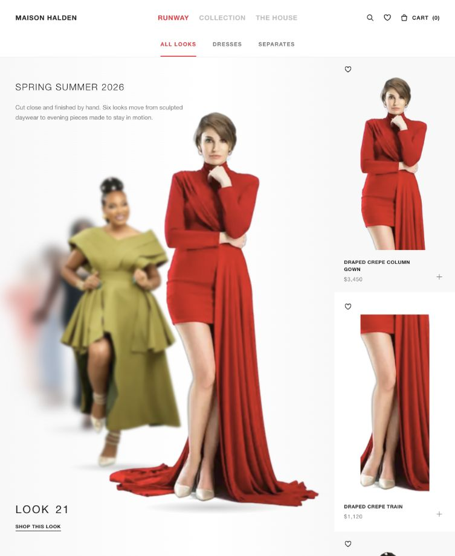
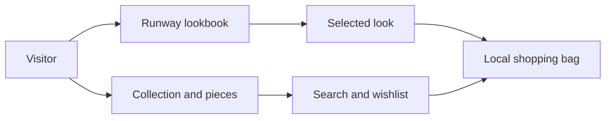

# Maison Halden — Spring Summer 2026

A fashion lookbook and storefront concept built with React, TypeScript and Vite. Explore six runway looks and their individual pieces, search the collection, save items to a wishlist and add pieces to a local bag.



## Explore

- Switch between looks in the interactive runway presentation.
- Browse dresses and separates, search pieces, and add them to the wishlist or bag.
- Navigate between the runway, collection and house sections.

The collection, prices and shopping interactions are a design concept. The bag does not process a real purchase or payment.

## Run locally

Requires Node.js compatible with the versions in `package.json`.

```sh
npm ci
npm run dev
```

Open the local URL printed by Vite. Build with `npm run build` and run lint with `npm run lint`.

## Application structure



The experience runs in the browser; no payment or order backend is included.
